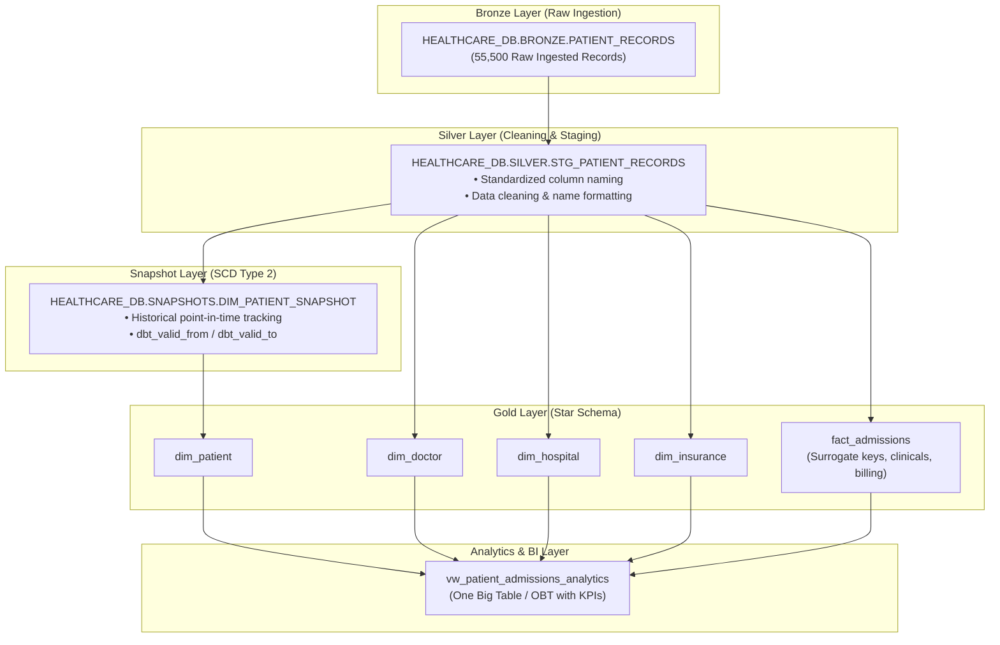

# 🏥 Healthcare Data Engineering Pipeline (Snowflake + dbt)

An end-to-end modern data engineering pipeline built with **Snowflake** and **dbt (Data Build Tool)** following the **Medallion Architecture (Bronze ➔ Silver ➔ Gold ➔ Analytics)**. The pipeline ingests 55,000+ patient records, cleanses and standardizes healthcare data, builds a dimensional Star Schema, tracks historical changes with SCD Type 2 Snapshots, and provides an analytics-ready reporting layer for BI tools.

---

##  Architecture Overview



---

## 🌟 Key Features

1. **Medallion Architecture**:
   - **Bronze**: Raw transactional healthcare data landing zone.
   - **Silver**: Cleansed, formatted, and standardized staging layer.
   - **Gold**: Dimensional data mart optimized for analytical queries.
   - **Analytics**: Denormalized One-Big-Table (OBT) view with pre-calculated KPIs (e.g., `length_of_stay_days`).

2. **Slowly Changing Dimensions (SCD Type 2)**:
   - Uses `dbt snapshot` with the `check` strategy to track patient demographic updates over time without losing historical context.

3. **Surrogate Key Generation**:
   - Implements `dbt_utils.generate_surrogate_key` to build deterministic MD5 surrogate primary keys across all dimension and fact tables.

4. **Custom Schema Management**:
   - Overrides default dbt prefix behavior with a custom `generate_schema_name` macro, deploying models cleanly into `HEALTHCARE_DB.SILVER` and `HEALTHCARE_DB.GOLD`.

5. **Automated Data Quality & Business Rule Testing**:
   - **Generic Tests**: Primary key `unique` and `not_null` constraints.
   - **Singular Tests**:
     - `assert_discharge_date_after_admission.sql`: Asserts logical chronology of patient stays.
     - `assert_billing_amount_positive.sql`: Asserts billing amounts are strictly non-negative.

---

##  Repository Structure

```text
healthcare-snowflake-pipeline/
├── .env.example                               # Environment configuration template
├── .gitignore                                 # Git rules excluding secrets & virtual environments
├── requirements.txt                           # Python dependencies (dbt-core, dbt-snowflake, etc.)
├── README.md                                  # Project documentation
│
└── healthcare_pipeline/                       # dbt Project Directory
    ├── dbt_project.yml                        # dbt project configurations & model materializations
    ├── packages.yml                           # dbt packages (dbt-labs/dbt_utils)
    ├── profiles.yml                           # Snowflake connection profiles
    │
    ├── macros/
    │   └── generate_schema_name.sql           # Custom macro removing target schema prefixes
    │
    ├── models/
    │   ├── source.yml                         # Source definitions for Snowflake upstream tables
    │   ├── silver/
    │   │   └── stg_patient_records.sql        # Silver staging model
    │   └── gold/
    │       ├── schema.yml                     # Documentation and data tests for Gold models
    │       ├── dim_patient.sql                # Patient dimension (sourced from snapshot)
    │       ├── dim_doctor.sql                 # Doctor dimension
    │       ├── dim_hospital.sql               # Hospital dimension
    │       ├── dim_insurance.sql              # Insurance provider dimension
    │       ├── fact_admissions.sql            # Hospital admissions fact table
    │       └── vw_patient_admissions_analytics.sql # Analytics-ready BI view
    │
    ├── snapshots/
    │   └── dim_patient_snapshot.sql           # SCD Type 2 patient snapshot
    │
    └── tests/
        ├── assert_billing_amount_positive.sql # Custom singular test for positive billing
        └── assert_discharge_date_after_admission.sql # Custom singular test for valid stay dates
```

---

##  Getting Started

### 1. Prerequisites
- **Python 3.10+** installed
- **Snowflake** account with a configured warehouse, database, and role

### 2. Set Up Virtual Environment & Dependencies
```powershell
# Create and activate virtual environment
python -m venv .venv
.\.venv\Scripts\Activate.ps1

# Install requirements
pip install -r requirements.txt
```

### 3. Install dbt Packages
Navigate into the dbt project folder and pull dependencies:
```powershell
cd healthcare_pipeline
dbt deps
```

### 4. Configure Snowflake Credentials
Set up your connection in `profiles.yml` or configure your environment variables using `.env.example`:
```powershell
# Test your Snowflake connection
dbt debug
```

---

##  Execution Commands

### Run Snapshots (SCD Type 2)
```powershell
dbt snapshot
```

### Build & Materialize Models (Silver & Gold)
```powershell
dbt run
```

### Execute Data Quality Tests
```powershell
dbt test
```

### Generate & View Interactive Documentation & DAG
```powershell
dbt docs generate
dbt docs serve
```
*Spins up a local server at `http://localhost:8080` displaying the data dictionary and dependency lineage graph.*

---

##  Dimensional Model (Gold Layer)

| Model Name | Materialization | Description |
| :--- | :--- | :--- |
| `dim_patient` | Table | Patient demographics filtered to current active records (`dbt_valid_to IS NULL`). |
| `dim_doctor` | Table | Distinct doctors with deterministic surrogate key `doctor_id`. |
| `dim_hospital` | Table | Distinct hospitals and facilities with surrogate key `hospital_id`. |
| `dim_insurance` | Table | Distinct insurance providers with surrogate key `insurance_id`. |
| `fact_admissions` | Table | Central fact table containing clinical diagnoses, medications, and billing. |
| `vw_patient_admissions_analytics` | View | Denormalized OBT view joining facts and dimensions with calculated `length_of_stay_days`. |

---

##  Data Governance & Compliance
- **PII / PHI Handling**: Patient identifiers and attributes are structured to easily plug in hashing salts or masking policies.
- **Git Safety**: Credentials and local profiles are guarded using `.gitignore`.